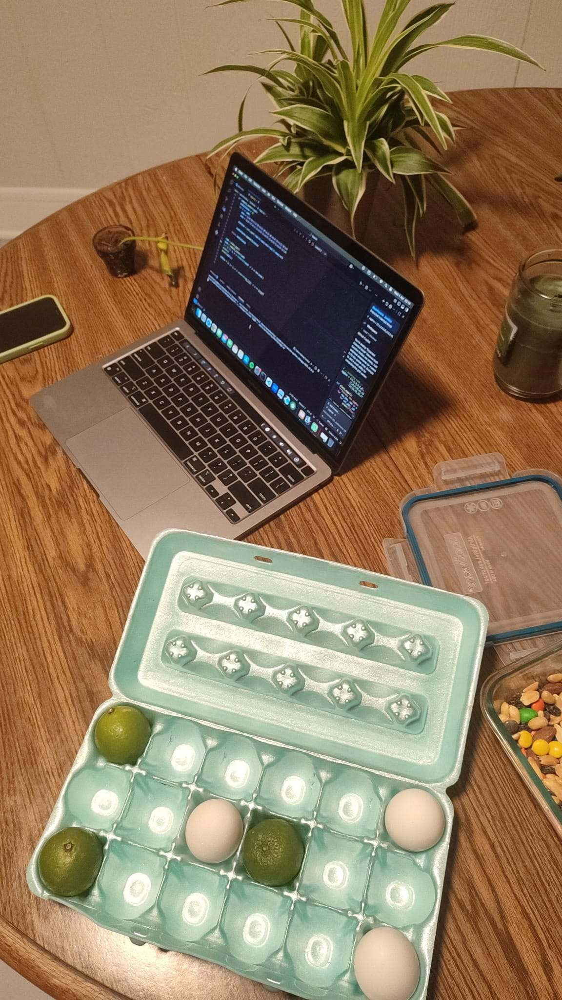

---
date:
  created: 2026-07-14
---

# The egg box problem

One weeknight mid semester in a sunny Cleveland, I was settling into a new place with a good friend and roommate, Shiv.
During this time I was baking some kind of [*lemon drizzle*](https://www.bbcgoodfood.com/recipes/lemon-drizzle-cake) each evening, and hence required many eggs.
While lifting a half empty egg box, with one hand, it felt slightly unbalanced.
It had occurred to me there was a non-zero chance I could have dropped the box.
In this thought, I asked Shiv if there is a different way we can store the eggs to minimize the risk of dropping the box?
The conversation and resulting outcome is what follows.

<!-- more -->

<figure markdown="span" style="float: right; width: 30%;">
{ style="width: 100%;" }
<figcaption>The eggbox.</figcaption>
</figure>

On the night of the eggbox problem we cobbled together some poorly written python code which could compute all combinations for an $n\times m$ egg box with $k$ eggs. 
After finding a satisfying solution (so we could safely store our eggs in the future) we discussed extensions and variants of the problem. 
Since then, I have no interest in writing any more python code.
However, Shiv came to the rescue and implemented a fun browser based game to test your egg balancing skills.
You can play the eggbox game on [*Shiv's website*](https://www.smauree.com/#eggbox-game)!
