

$$
% Category theory
\newcommand{\xto}[1]{\xrightarrow{#1}}
\newcommand{\To}{\Rightarrow}
\newcommand{\Ob}{\operatorname{Ob}}
\newcommand{\Hom}{\operatorname{Hom}}
\newcommand{\id}{\operatorname{id}}
\newcommand{\op}{\mathrm{op}}
\newcommand{\co}{\mathrm{co}}
\newcommand{\coop}{\mathrm{coop}}
% Categories
\newcommand{\cat}[1]{\mathsf{#1}}
\newcommand{\Set}{\mathsf{Set}}
% Morphism classes
\newcommand{\inj}{\cat{inj}}
\newcommand{\surj}{\cat{surj}}
\newcommand{\bij}{\cat{bij}}
\newcommand{\all}{\cat{all}}
\newcommand{\idnt}{\cat{id}}
% Double category theory
\newcommand{\proto}{\mathrel{\mkern3mu\vcenter{\hbox{$\shortmid$}}\mkern-10mu{\to}}}
\newcommand{\xproto}[1]{\ \overset{#1}{\proto}\ }
\newcommand{\proTo}{\mathrel{\mkern3mu\vcenter{\hbox{$\scriptstyle\mid$}}\mkern-8mu{\Rightarrow}}}
% Double categories
\newcommand{\dbl}[1]{\mathbb{#1}}
\newcommand{\Span}{\mathbb{S}\mathsf{pan}}
\newcommand{\B}{\mathbb{B}}
\newcommand{\ThPromnd}{\mathbb{T}_{\cat{Promnd}}}
\newcommand{\DblFam}{\mathbb{F}\mathsf{am}}
\newcommand{\DblFamOp}{\mathbb{F}\mathsf{am}^*}
\newcommand{\DblFamLR}{\mathbb{F}\mathsf{am}_{L,R}}
\newcommand{\DblFamOpLR}{{\mathbb{F}\mathsf{am}^*_{L,R}}}
$$

The category of sets and functions is a favourite of category theorists.
Among its special features, it is the free coproduct cocompletion of the
terminal category. But functions are not the only sensible mapping you
can consider between sets; take, for example, partial functions. A
similar free-cocompletion characterisation of the category of sets and
partial functions is more elusive. One satisfying resolution comes from
double categories.

For a double category, we can define its double category of families,
which is its free coproduct completion. However, unlike the
$1$-categorical case, the construction can be parameterised by certain
classes of functions, giving many kinds of family construction. A
specific choice of parameterisation does exhibit the double category of
sets, functions and partial functions as a free coproduct completion of
the terminal double category.

However, with the new understanding we can do even more. We can redefine
what it means for a double category to have products via a contravariant
family construction. Then, using these refined classes of products, we
can define a 'double category of partial maps' as a double category with
a particular class of products. A double category of partial maps then
has an underlying bicategory of partial maps as in Carboni (1987).

Finally, the theory extends to (co)virtual double categories, giving a
notion of product in a virtual double category and of coproduct in a
covirtual double category. This generalisation is useful in (co)virtual
double categories of spans and cospans, which exist for any category,
not just those with pullbacks or pushouts.

This is joint work with Evan Patterson from this summer; it accompanies
a [talk](https://www.youtube.com/watch?v=xa04dVG4fEs) and a forthcoming
paper.

# Background

## The family construction

The category $\mathbf{Set}$ of sets and functions is the free coproduct
completion of the terminal category ([nLab]{.nocase} (2026)). To see the
result, we can define a free coproduct completion via the family
construction.

**Definition 1** For a category $\mathsf{C}$, the *category of families
$\mathsf{Fam}(\mathsf{C})$* is defined as follows:

- objects $(I,x)$ are a set $I$ with $I$-indexed objects $x_i$ of
  $\mathsf{C}$;
- morphisms $(f_0,f)\colon (I,x)\to (J,y)$ are a function
  $f_0\colon I\to J$ with $I$-indexed morphisms
  $f_i\colon x_i\to y_{f_0(i)}$ of $\mathsf{C}$.

There is an inclusion
$\Delta\colon \mathsf{C}\to \mathsf{Fam}(\mathsf{C})$ given by sending
objects and morphisms to the objects and morphisms indexed by the
singleton set, $1$. We then obtain the universal property: for any
functor $F\colon \mathsf{C}\to \mathsf{D}$, where $\mathsf{D}$ has small
coproducts, there exists an essentially unique coproduct-preserving
functor $\hat{F}\colon \mathsf{Fam}(\mathsf{C})\to \mathsf{D}$ such that
the diagram

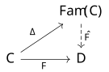

commutes.

Can we trace the universal property in reverse? From the family
construction on a category, how do we recover the coproduct? If
$\mathsf{C}$ has coproducts, then we can define
$\Sigma:= \widehat{\mathsf{id}_{\mathsf{C}}} \colon \mathsf{Fam}(\mathsf{C})\to \mathsf{C}$.
It is a fun exercise to show that a category $\mathsf{C}$ has coproducts
if and only if the inclusion
$\Delta\colon \mathsf{C}\to \mathsf{Fam}(\mathsf{C})$ admits a left
adjoint, $\Sigma\dashv \Delta$. So, starting from the family
construction, we can characterise coproducts by the existence of a left
adjoint.

Using the tools of category theory, there is a nice way to describe the
family construction. The family construction is the free coproduct
completion monad. The algebras over the monad give categories with
coproducts. The unit of the monad is the inclusion of a category into
the category of families, and the multiplication is taking coproducts in
the category of families. If $\mathsf{C}$ is an algebra, then the
algebra laws force the algebra action, $\Sigma$, to be isomorphic to
taking coproducts in $\mathsf{C}$. In fact, $\mathsf{Fam}$ is what's
called a lax-idempotent monad on $\mathbf{Cat}$, which tells us that the
algebra structure, if it exists, is unique up to isomorphism (see Kelly
and Lack (1997)).

## Families of double categories

When we start looking at higher-dimensional category theory, in
particular in double categories, it is not uncommon for definitions that
agree in the $1$-categorical case to diverge. In this case, you may want
to define a coproduct as an initial cocone over a discrete diagram
$F\colon I\to \mathsf{C}$ or as a left adjoint to the inclusion
$\Delta\colon \mathsf{C}\to \mathsf{Fam}(\mathsf{C})$, depending on
which is convenient.

In their seminal paper, Grandis and Paré (1999) extended the former
definition to the setting of double categories. They defined what it
means for a double functor $F\colon \mathbb{I} \to \mathbb{D}$ from a
small double category to have a (co)limit. In particular, when
$\mathbb{I}$ is discrete, we obtain a definition for a double
(co)product.

The free completion under the Grandis-Paré coproduct may appear
unsatisfying when you consider certain double categories. Specifically,
taking the terminal double category, $𝟙$, and freely adding double
coproducts, we obtain the double category of sets, functions, trivial
proarrows and cells. If you know some double category theory, you may
have expected the answer to be $\mathbb{S}\mathsf{pan}$, the double
category of sets, functions, spans and span homomorphisms.
$\mathbb{S}\mathsf{pan}$ plays a crucial role in double category theory
as exhibited, for example, in Paré (2011), where the double Yoneda
embedding lands in the virtual double category of
$\mathbb{S}\mathsf{pan}$-valued double functors.

A remedy for this problem is an idea introduced by Paré (2009) and
developed by Patterson (2026). Evan defined a double family construction
$\mathbb{F}\mathsf{am}(\mathbb{D})$, the key difference being that we
index the proarrows in $\mathbb{D}$ by arbitrary spans of sets
$I\leftarrow A\rightarrow J$, and redefined a double coproduct as a lax
left adjoint to the inclusion
$\Delta \colon\mathbb{D}\to \mathbb{F}\mathsf{am}(\mathbb{D})$,
mirroring the $1$-categorical case. Restricting to identity spans
recovers Grandis and Paré's definition. Furthermore, completing with
respect to the new notion of coproduct gives us the desired result,
$\mathbb{F}\mathsf{am}(𝟙)\cong\mathbb{S}\mathsf{pan}$.

## Virtual double categories

We are assuming the reader is familiar with category theory and knows of
double categories, but may not have come across virtual double
categories (VDCs). It is worth spending some time to get used to VDCs
since they are becoming increasingly useful in the study of formal
category theory. The idea was first introduced by Burroni (1971) as the
case $\mathrm{T}=\mathrm{fc}$ of his '$\mathrm{T}$-categories', where
$\mathrm{fc}$ is the free-category monad. Virtual double categories were
then developed by Leinster (2004) where they are called
'$\mathrm{fc}$-multicategories'. We will use the name and notation from
Cruttwell and Shulman (2010).

One benefit of virtual double categories is that we can now capture
examples such as $\mathbb{C}\mathsf{ospan}(\mathsf{C})$, which can be
defined even when $\mathsf{C}$ does not have pushouts. For us, this
means we can define products in the virtual double category
$\mathbb{C}\mathsf{ospan}(\mathsf{C})$. Later in this post, we will
include an example of the dual situation: coproducts in covirtual double
categories.

Before seeing a virtual double category, it is worth remembering what a
double category is. A double category, $\mathbb{D}$, is a category
object internal to $\mathbf{Cat}$. We will denote the underlying
category of objects and arrows as $\mathbb{D}_0$ and of proarrows and
cells as $\mathbb{D}_1$. Double categories have proven useful since they
can package together two kinds of arrows in the same structure. For
example, sets typically have functions as maps between them, and
functions are very well studied. However, there are other kinds of
mappings between sets such as relations, partial functions and spans. We
can define the double categories $\mathbb{P}\mathsf{ar}$ or
$\mathbb{S}\mathsf{pan}$ with functions as arrows and partial functions
or spans as the proarrows. This allows us to study partial functions or
spans through their relationship with functions.

The step from double categories to virtual double categories is a small
one. We forget about the composition of proarrows, and to compensate we
let the cells have an arbitrary composable string of proarrows as their
source.

**Definition 2** A *virtual double category* $\mathbb{D}$ has as data:

- objects, $x$;
- arrows, $f\colon x\to y$;
- proarrows, $u\colon x\proto y$;
- cells,

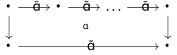

- arrow composition;
- cell composition

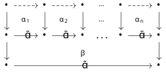

$$=$$

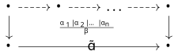

- identity arrows;
- identity cells;

subject to the axioms:

- objects and arrows form a category;
- associativity and identity axioms for cell composition.

To recover the relation to double categories, we can define notions of
virtual double functors and transformations as the maps preserving the
relevant structure. Then there is an inclusion (fully faithful on
$1$-cells and $2$-cells) of the $2$-category of double categories, lax
functors and transformations, into the $2$-category of virtual double
categories, virtual functors and transformations.
$$\mathbf{Dbl}_{\mathrm{lax}} \hookrightarrow \mathbf{vDbl}$$

As mentioned in the intro, we can define
$\mathbb{S}\mathsf{pan}(\mathsf{C})$ even when $\mathsf{C}$ doesn't have
pullbacks. First, we need to dualise our definition of a VDC to get
what's called a covirtual double category (coVDC). Notice how simply
reversing the arrows in a VDC will not give us back a VDC, due to the
asymmetry of the multi-source and single-target of the cells. So, define
a coVDC to consist of objects, arrows, proarrows and cells of the shape

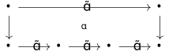

Notice that coVDCs also generalise double categories by forgetting loose
composition.

Now we can give a use for this abstraction, hinted at already. The
following example can be found in Dawson et al. (2010), Proposition 4.3,
where covirtual double categories are named oplax double categories.

**Example 1** For *any* category $\mathsf{C}$ define the covirtual
double category $\mathbb{S}\mathsf{pan}(\mathsf{C})$ as:

- having objects and arrows, the objects and arrows of $\mathsf{C}$;
- having proarrows, spans of arrows of $\mathsf{C}$,
  $X\leftarrow A\rightarrow Y$;
- having cells, a collection of arrows of $\mathsf{C}$,
  $\alpha_i\colon B \to A_i$ such that the diagram

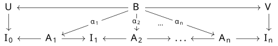

commutes.

Since we didn't need to compose spans, we never needed pullbacks. If
$\mathsf{C}$ has pullbacks, then, by the universal property, the maps
$\alpha_i$ form a cone over the pullback diagram and hence give a unique
map into the pullback. Therefore, our definition and the one defined by
maps into the pullback coincide.

# The family construction for virtual double categories

Now that we have *familiarised* ourselves with virtual double categories
and the family construction, we will put them together to get the family
construction on VDCs. The definition will seem a little intimidating, so
first let's figure out how we get there.

To come up with the definition, there's one thing we know already: we
want the construction to be the same on objects and arrows as for the
family construction on categories. This leaves us to decide what happens
on proarrows and cells. For a double category $\mathbb{D}$, we want to
index both underlying categories, $\mathbb{D}_0$ and $\mathbb{D}_1$,
with a discrete category. We could choose the same set $I$ indexing both
categories, giving us a diagram,

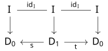

However, it makes just as much sense to index the categories by
different underlying sets with functors (functions since the categories
are discrete) that commute with the source and target functors,

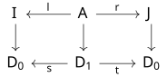

This idea, first due to Paré (2009), is what we mean when we *index by a
span* of sets $I\leftarrow A \rightarrow J$. We can index cells by span
morphisms. Although we don't have diagrams like the one above in virtual
double categories, we can still perform a similar construction.

**Definition 3 (Family construction on VDCs)** For a virtual double
category $\mathbb{D}$, the *(contravariant) family construction
$\DblFamOp(\mathbb{D})$* is defined as follows:

- objects, $(I,x)$, are a set $I$ and an $I$-indexed family of objects
  in $\mathbb{D}$;
- arrows, $(f_0,f)\colon (I,x)\to (J,y)$, are a function
  $f_0\colon J \to I$ and a $J$-indexed family of arrows
  $f_j\colon x_{f_0(j)}\to y_{j}$ in $\mathbb{D}$;
- proarrows, $(A, p)\colon (I,x)\proto (J,y)$, are a span
  $I\overset{l}{\leftarrow} A \overset{r}{\rightarrow} J$ and a
  span-indexed family of proarrows $p_a\colon x_{l(a)}\proto y_{r(a)}$
  in $\mathbb{D}$;
- cells, $(\alpha_0,\alpha)$,

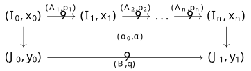

are a morphism of spans,

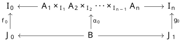

and a $(J_0\leftarrow B\rightarrow J_1)$-indexed family of cells

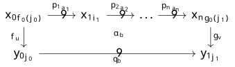

in $\mathbb{D}$.

> **Covariant vs contravariant**
>
> You may have noticed the arrows in the construction here are going in
> the opposite direction to the one you might expect. This is because we
> are giving the contravariant family construction, so that we can
> define products rather than coproducts. To define coproducts in a
> double category, we need to consider the covariant family
> construction, which generalises to *covirtual* double categories. To
> avoid getting into the weeds, we will present the contravariant
> version where we write $*$ and hope the reader can dualise where
> necessary. To help remember the upcoming terminology, note:
> $* \implies$ contravariant $\implies$ colax-idempotent $\implies$
> right adjoint gives products, and no $* \implies$ covariant $\implies$
> lax-idempotent $\implies$ left adjoint gives coproducts.

We find that the double family construction here, similarly to the
$1$-categorical case, is a (co)lax-idempotent monad. So, we get many
similar results such as the family construction being a free completion
and the algebra structure being unique. However, the difference from the
$1$-categorical case is that we have many different double-categorical
family monads parameterised by the definition below.

## Span indexing pairs

Indexing proarrows by a span gives us a lot more freedom in what we
index by. It is no longer just the indexing set that can vary, but also
the functions in the legs of the span. We can notice that certain
classes of these functions, for example injections, are closed under the
operations which encode the family monad. So there is not just one
family monad but many, depending on which class of functions we choose
for the legs of the span. In particular, we have the following:

**Definition 4 (Span indexing pair)** A *span indexing pair*, $(L,R)$,
is a pair of classes of functions satisfying:

- (pullback closure) if $l,l^\prime \in L$ and $r,r^\prime \in R$ then
  in the pullback square below $f \in L$ and $g \in R$.

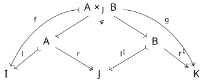

- (coproduct closure) for a collection of arrows
  $p_a\colon S_a \rightarrowtail V_{r(a)}$ in $L$ (resp. $R$) indexed by
  a function $r\colon A\rightarrowtail J$ in $L$ (resp. $R$), the
  copairing of arrows
  $$[\iota \circ p_a]_{a\in A}\colon \bigsqcup_{a\in A}S_a\rightarrowtail \bigsqcup_{j\in J}V_j$$
  is also in $L$ (resp. $R$).

- (unit) $\id_{1}\colon 1 \to 1$ is in $L$ and $R$.

The definition reflects exactly the conditions we need for the double
family construction to assemble into a monad.

Examples of span indexing pairs seem to come in two flavours:
subcategories such as $\surj$ or $\inj$ and small examples such as the
set of all maps out of the initial set, $\varnothing$. The classes of
interest are:

  -----------------------------------------------------------------------
  class                   functions
  ----------------------- -----------------------------------------------
  $\all$                  all functions

  $\bij$                  bijections

  $\surj$                 surjections

  $\inj$                  injections

  $\idnt$                 identity functions

  $\varnothing$           functions out of the empty set (initial)

  $!$                     functions into the singleton set (terminal)

  $\idnt_{\varnothing}$   $\{\id_\varnothing,\id_{1}\}$

  $\idnt_{1}$             $\{\id_{1}\}$
  -----------------------------------------------------------------------

They can be arranged into a nice diagram below.

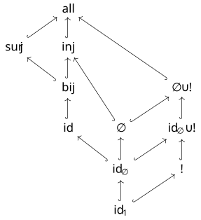

Note that not every class can pair with every other class to form a
valid span indexing pair, as together the pullback condition needs to be
satisfied.

We can now define a refined family construction
$\mathbb{F}\mathsf{am}_{(L,R)}(\mathbb{D})$ by only indexing by spans
with the left leg in $L$ and right leg in $R$.

**Theorem 1 (Generalised family monads)** For a span indexing pair
$(L,R)$ there is a colax-idempotent pseudomonad,
$$\DblFamOpLR \colon \mathbf{vDbl}\to \mathbf{vDbl},$$ given by the
family construction. The unit of the pseudomonad,
$\Delta\colon \id \Rightarrow \DblFamOpLR$, is the inclusion at the
singleton set, and the multiplication,
$\Sigma\colon \DblFamOpLR^2\Rightarrow \DblFamOpLR$, is taking the
coproduct over the indexing sets.

Dually, for a span indexing pair $(L,R)$, there is a lax-idempotent
pseudomonad, $\DblFamLR\colon \mathbf{covDbl}\to \mathbf{covDbl}$. Both
of the monads restrict to monads on the $2$-category of double
categories. This presentation of the result gives us what we need to
recover the leading example.

**Example 2** A partial function is equivalently a span of functions
whose left leg is an injection. Therefore,
$$\mathbb{P}\mathsf{ar} \simeq \DblFam_{(\inj,\all)}(𝟙).$$

The next section briefly explains what products we can now define in
virtual double categories.

# (Virtual) double products

As in the $1$-categorical case, we can move from the family construction
to (co)products by taking adjoints to the inclusion. The bonus now is
that we have many different family monads which describe different kinds
of (co)products.

**Definition 5 ((L,R)-products)** A virtual double category $\mathbb{D}$
has *$(L,R)$-products* if the inclusion
$\Delta\colon \mathbb{D}\to \DblFamOpLR(\mathbb{D})$ has a right
adjoint, $\Pi\colon \DblFamOpLR(\mathbb{D})\to \mathbb{D}$.

In a virtual double category we can take products of objects just as in
a $1$-category, but we can also take a product $\Pi(A,m)$ of a family of
proarrows, which is again a proarrow. We get some interesting kinds of
proarrow which exhibit the universal property of a product.

**Example 3** For a *double* category $\mathbb{D}$ with
$(\all,\all)$-products, we call:

- a product of proarrows indexed by $[2]=[2]=[2]$ a *parallel product*
  $$u\times v \colon x\times x^\prime \proto y\times y^\prime;$$
- a product of proarrows indexed by
  $[1]\overset{!}{\leftarrow} [2]\overset{!}{\rightarrow} [1]$ a *local
  product* $$p\times p^\prime \colon x\proto y;$$
- a product of identity proarrows indexed by
  $[2]=[2]\overset{\sigma_{12}}{\to}[2]$ a *braiding*
  $$ \sigma_{x} \colon x\times x \proto x\times x;$$
- a product of identity proarrows indexed by
  $[1]\overset{!}{\leftarrow} [2]=[2]$ a *diagonal*
  $$\delta_x\colon x\proto x\times x.$$

These examples are not exhaustive but give an idea of the different
interesting structures which appear as products.

The post is getting long, so we will end by stating one benefit of our
abstraction, leaving the details to the upcoming paper.

Provided the $(L,R)$-product functor is normal (preserves identities in
the proarrow direction), products can be exhibited as companions or
conjoints. That is, the existence of *normal* $(L,R)$-products in a
double category (products where the product functor is normal) implies
the existence of particular companions and conjoints. Using this idea,
we can express known bicategorical structure which arises as the
underlying bicategory of a double category with $(L,R)$-products.

We can also ask if the $(L,R)$-product functor is pseudo, that is, it
preserves compositions in the proarrow direction. In this case, we say
the products are *$(L,R)$-strong*.

The motivating example of this idea is a double category of partial
maps.

**Definition 6 (Double categories of partial maps)** A double category
with $(\surj,\idnt)$-strong $(\all,\surj)$-products is called a *double
category of partial maps*.

The definition comes from trying to mimic the structure of a bicategory
of partial maps in Carboni (1987). For example, the comultiplication
structure on each object comes from the product structure maps, which
transpose to an $(\idnt,\surj)$-product in the proarrow direction.
Therefore, we get that the underlying bicategory of a double category of
partial maps is indeed a bicategory of partial maps.

# Summary

(Co)limits in double categories were first studied by Grandis and Paré.
To capture more examples of universal structures, even in the case of
products, we approach the question from a different perspective. From
the new perspective there are many more features we can outline which
give rise to different and interesting structures. For example, we saw
that we can state double-categorical analogues of bicategorical
structure via products. We also find that a generalisation to the
setting of virtual double categories gives a stronger universal property
which opens the door to more examples to study.

A motivating next question: how can we recover a similar perspective for
more general (co)limits, and what kinds of structure can we exhibit from
those universal properties?[^1]

# References

Burroni, Albert. 1971. "$T$-Catégories (Catégories Dans Un Triple)."
*Cahiers de Topologie Et Géométrie Différentielle Catégoriques* 12 (3):
215--321. <https://www.numdam.org/item/CTGDC_1971__12_3_215_0/>.

Carboni, Aurelio. 1987. "Bicategories of Partial Maps." *Cahiers de
Topologie Et Géométrie Différentielle Catégoriques* 28 (2): 111--26.
<http://eudml.org/doc/91396>.

Clarke, Bryce, and Nathanael Arkor. 2025. "A New Framework for Limits in
Double Categories."
<https://archive.math.muni.cz/conference/ct2025/data/uploads/abstracts/clarke.pdf>.

Cruttwell, G. S. H., and Michael A. Shulman. 2010. *A Unified Framework
for Generalized Multicategories*. <https://arxiv.org/abs/0907.2460>.

Dawson, Robert, Robert Paré, and Dorette Pronk. 2010. "The Span
Construction." *Theory Appl. Categ.* 24: 302--77.

Grandis, Marco, and Robert Paré. 1999. "Limits in Double Categories."
*Cah. Topologie Géom. Différ. Catégoriques* 40 (3): 162--220.
<https://eudml.org/doc/91618>.

Kelly, G. M., and Stephen Lack. 1997. "On Property-Like Structures."
*Theory Appl. Categ.* 3: 213--50. <https://eudml.org/doc/120206>.

Leinster, Tom. 2004. *Higher Operads, Higher Categories*. Vol. 298.
London Mathematical Society Lecture Note Series. Cambridge University
Press. <https://doi.org/10.1017/CBO9780511525896>.

[nLab]{.nocase}. 2026. *Free Coproduct Completion*.
[Https://ncatlab.org/nlab/show/free+coproduct+completion](https://ncatlab.org/nlab/show/free+coproduct+completion){.uri}.

Paré, Robert. 2009. *First Order Theories as Double Lawvere Theories*.
Conference talk presented at CT2009.
<https://www.mscs.dal.ca/~pare/CapeTown2009.pdf>.

Paré, Robert. 2011. "Yoneda Theory for Double Categories." *Theory Appl.
Categ.* 25: 436--89.
<http://www.tac.mta.ca/tac/volumes/25/17/25-17abs.html>.

Patterson, Evan. 2026. "Products in Double Categories, Revisited."
*Theory Appl. Categ.* 45: 537--601.
[www.tac.mta.ca/tac/volumes/45/16/45-16abs.html](https://www.tac.mta.ca/tac/volumes/45/16/45-16abs.html).

[^1]: Work in this area is developing: a great exposition of a unified
    framework is given by Clarke and Arkor (2025).
